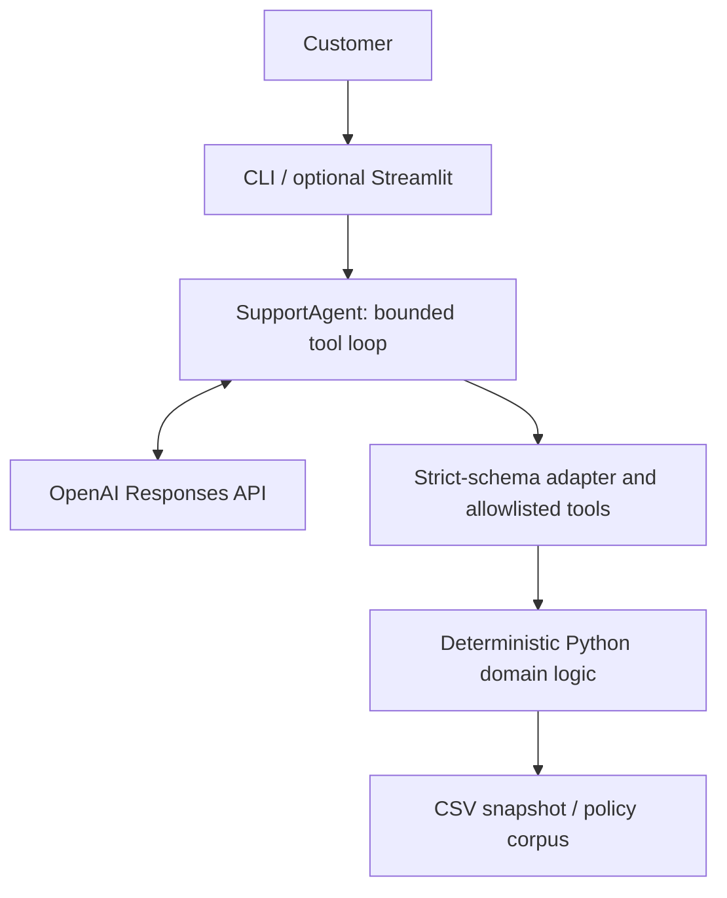

# Empório da Música — AI Customer Support Agent

A Python support agent for a fictional musical-instrument store, built for the Artefact AI Engineer technical challenge. It answers Portuguese and English messages, consulting structured operational data and the supplied store-policy manual. The language model handles dialogue and tool selection; deterministic Python code handles prices, availability and order authorization.

## Live demo

A deployed demonstration of the optional Streamlit interface is available at [Empório da Música — live demo](https://artefact-ai-engineer-case-live-demo.streamlit.app).

It uses the same `SupportAgent` as the CLI, which remains the primary minimal interface. Messages sent to the demo may make live model calls.

## Features

- Product discovery, details, stock and availability from the supplied snapshot.
- Current unit-price quotes with active promotions and non-stacking PIX discounts.
- Customer-bound order lookup and order history, preserving recorded totals.
- Policy retrieval with filename, SHA-256, version, section and page provenance.
- Portuguese/English interaction and explicit handling of conflicting sources.
- Bounded strict function calling and in-session conversation continuity.
- A primary interactive CLI and an optional Streamlit chat interface.
- An offline test suite using synthetic fixtures and a fake provider client.

The prototype is read-only: it does not purchase instruments, approve refunds, cancel orders or contact carriers.

## Architecture



The model decides when to use a tool; deterministic application code remains authoritative for operational facts, authorization and pricing. The model does not receive direct file access or the customer directory.

## Why this architecture

Separating language generation from domain rules reduces invented operational facts and makes the rules independently testable. Application-owned identity stays outside model-controlled order arguments. One small agent and a section retriever are sufficient for the supplied data; a database, agent framework and vector service would add infrastructure without helping demonstrate this case. Both interfaces remain thin orchestration layers.

## Model and provider

- **Provider:** OpenAI.
- **API:** Responses API, using `openai==3.42.0`.
- **Default verified model:** `gpt-6.1-terra`.

Live checks verified text responses, strict function calls, call IDs and nullable optional arguments. The five examples below were captured in new real model-backed runs. No model-comparison benchmark is claimed, and there is no automatic fallback. The programmatic agent accepts a model override for testing/configuration; the CLI and UI use its default.

## Tool design

| Tool | Responsibility |
| --- | --- |
| `search_products` | Search source fields and filter by category, current unit-price budget or availability. |
| `get_product_details` | Return original product fields, current price and availability. |
| `get_order_status` | Return one order belonging to the application-supplied demo customer. |
| `list_my_orders` | Return that customer's historical orders, including cancelled orders. |
| `search_store_policies` | Retrieve complete relevant policy sections with provenance. |

Internal schemas allow optional arguments to be omitted. The OpenAI adapter marks every provider property required and makes internally optional properties nullable, including enums. It removes optional nulls before the existing local validator runs. Unknown tools and unexpected arguments are rejected.

The loop disables parallel tool calls and allows at most four tool rounds and eight executions per customer turn by default. Requests have a 1,024-token output cap. The default client has a 45-second timeout and no automatic retries. Expected provider failures produce safe project exceptions.

## Data and privacy

The challenge-provided raw files are intentionally not committed to the public repository.

Supply a directory containing the six CSV datasets: `categories`, `products`, `promotions`, `customers`, `orders` and `order_items`. The loader accepts either `products.csv`-style names or the original `desafio_tecnico_ai_eng - products.csv` naming convention. Missing, ambiguous or structurally invalid sources fail explicitly.

The loader validates columns, identifiers and references and preserves money as `Decimal`, dates as dates, and source descriptions/specifications. Availability requires active status and enough stock. Pricing applies one active promotion or the standard 5% PIX discount, never both, using cent rounding with `ROUND_HALF_UP`. Ambiguous active promotions produce a controlled error.

Customer identity is application/session context. `customer_id` is never a model-controlled tool argument. The CLI's optional identity flag only simulates a known customer; it is not authentication. Missing and unauthorized orders deliberately produce the same public not-found result. Model-facing order views exclude customer identity/contact fields and preserve historical totals, tracking and estimates.

Public test data is synthetic. The example transcripts were privacy-reviewed and contain no customer identity or contact data; store contact numbers are allowed policy content. Operational data remains a preloaded local snapshot, not a live ERP or carrier feed.

## Policy retrieval

The PDF loader preserves pages, numbered sections and source provenance. Parent sections include their subsections, so rules remain together. Retrieval normalizes case, accents and punctuation, ranks distinct lexical term matches with extra title weight, and preserves source order for ties.

There is no embedding service or vector database. Source contradictions remain intact rather than being silently corrected. The conflicting WhatsApp numbers are an intentional uncertainty-handling example. Product name, description and specification conflicts are also preserved. Return guidance asks for missing facts rather than approving an individual request.

## Conversation state

The agent keeps the last completed response ID in memory and chains requests with `previous_response_id`. Stable instructions and approved tools are sent on every request. Failed turns do not replace the last completed session state.

There is no application database or local transcript persistence. Responses use `store=True`, so conversation content is stored by OpenAI: this is a prototype trade-off, not a claim of local-only storage. Streamlit additionally keeps display-only messages in browser-session state. **New conversation** resets the local demo session; it does not delete provider-side Responses.

## Interfaces

**CLI is the primary interface.** It supports multiple customer turns, ignores blank messages, and exits normally on `exit`, `quit`, EOF or Ctrl+C. Normal output contains only customer-facing answers.

**Streamlit is optional.** It uses the same `SupportAgent`, native chat elements, one agent per active browser conversation, a loading indicator and a new-conversation control. No business or authorization logic lives in the UI.

## Installation

Requires Python 3.12 or newer. The verified Windows environment uses Python 3.12.13. From the repository root in PowerShell:

```powershell
python -m venv .venv
.\.venv\Scripts\python.exe -m pip install -e ".[dev,ui]"
```

For the CLI without Streamlit, install `".[dev]"` instead. The `ui` extra pins `streamlit==1.66.1`; core runtime dependencies are `openai==3.42.0` and `pypdf==6.21.4`. The development extra pins `pytest==9.2.0`. Unix commands are not presented as verified.

## Environment configuration

Live model execution requires an OpenAI API key, model access and available API quota. Offline tests require none of these.

```powershell
$env:OPENAI_API_KEY = "<YOUR_OPENAI_API_KEY>"
```

Never commit the key. To avoid placing its value in shell history, use a masked prompt instead:

```powershell
$sessionApiKey = Read-Host "OpenAI API key" -AsSecureString
$env:OPENAI_API_KEY = [System.Net.NetworkCredential]::new("", $sessionApiKey).Password
Remove-Variable sessionApiKey
```

The application reads the process environment, accepts no API-key CLI argument and does not automatically load `.env` files.

## Running the CLI

Replace the placeholders with the paths where you stored the provided challenge files:

```powershell
.\.venv\Scripts\emporio-support.exe `
  --data-dir "<PATH_TO_CSV_DIRECTORY>" `
  --policy-pdf "<PATH_TO_POLICY_PDF>"
```

Equivalent module entry point:

```powershell
.\.venv\Scripts\python.exe -m emporio_support_agent `
  --data-dir "<PATH_TO_CSV_DIRECTORY>" `
  --policy-pdf "<PATH_TO_POLICY_PDF>"
```

The installed command is `emporio-support` when the environment's `Scripts` directory is on `PATH`. Both entry points support `--help`. Optionally append `--customer-id <CUSTOMER_ID>` with a positive demo identity for order queries. Without it, product/policy questions work and order tools report that customer context is required.

## Running the optional Streamlit UI

With the `ui` extra installed and the key available:

```powershell
.\.venv\Scripts\streamlit.exe run src/emporio_support_agent/streamlit_app.py --server.address 127.0.0.1 -- `
  --data-dir "<PATH_TO_CSV_DIRECTORY>" `
  --policy-pdf "<PATH_TO_POLICY_PDF>"
```

The optional `--customer-id <CUSTOMER_ID>` has the same demo-only meaning as in the CLI and is not displayed. Source files must be provided separately for local execution; original challenge data is excluded from this public repository.

## Testing

```powershell
.\.venv\Scripts\python.exe -m pytest -q
.\.venv\Scripts\python.exe -m pip check
```

The final suite contains **425 passing tests**. Normal pytest execution performs zero external network calls. Provider behavior is scripted in tests; deterministic domain tools remain real. Streamlit AppTest covers reruns, history, reset, configuration, safe errors and display privacy. UI tests skip when the optional dependency is absent.

Live provider checks are separate from pytest. Passing offline tests does not establish API access or model answer quality.

## Conversation examples

These are exact conversations captured from new live `gpt-6.1-terra` runs, rather than fabricated transcripts. Grounding notes identify the tools used without exposing provider IDs or customer identity.

1. [Product price and availability](examples/01-product-availability.md)
2. [Promotion, PIX and a related follow-up](examples/02-promotion-pix.md)
3. [Customer-bound order status](examples/03-order-status.md)
4. [Online return-policy clarification](examples/04-online-return-policy.md)
5. [Conflicting contact information in English](examples/05-conflicting-contact-policy.md)

## Technical decisions and trade-offs

- **CLI first:** the challenge did not require a frontend; the CLI kept the primary interface small.
- **Optional Streamlit:** a presentation layer added without changing the domain or agent.
- **Deterministic tools:** pricing, availability and authorization are independently testable Python rules.
- **Lexical retrieval:** complete sections suit the small manual, with less infrastructure than vector search.
- **In-session history:** sufficient for this prototype, with no database to operate.
- **Provider adapter:** OpenAI strict-schema requirements stay separate from internal tool contracts.

## Known limitations

Identity is simulated, not authenticated. Local session state is not durable. Retrieval is lexical, with no semantic-search evaluation. There is no human-agent handoff, transaction execution, production observability, provider fallback, production rate limiting or deployment/security hardening. Model behavior is probabilistic despite grounding instructions, and provider-side Responses are stored during prototype sessions.

The public repository intentionally excludes original challenge inputs, so a reviewer needs the provided source files to run operational conversations. Policy extraction targets the supplied text-PDF layout; it is not a general OCR solution. Historical snapshots and contradictory source fields do not establish current real-world facts.

## What I would improve with more time

Real authentication, durable session management, structured observability and evaluations, human handoff, explicit customer-facing policy citations, a larger adversarial test set, configurable provider routing, and production rate limiting/abuse controls.

## AI coding-assistant disclosure

I used OpenAI ChatGPT and Codex as development assistants during this challenge for requirements decomposition, implementation planning, code/test drafting, documentation review and iterative code review.

The repository includes the resulting implementation, automated tests and genuine incremental commits. Verification included offline tests, separate live provider/tool-calling runs and CLI checks; the optional UI also has automated AppTest coverage. The conversation artifacts were captured from actual live runs and checked for grounding and privacy. AI assistance is disclosed rather than presenting the work as unaided or every line as independently handwritten.

## Repository and challenge notes

This is a technical-challenge prototype for a fictional store, not a production customer portal. Raw inputs, local development instructions and secrets are excluded from the official public repository.

Feature development is frozen. After final verification, the repository is frozen for submission. The submission PDF/form and official submission timestamp are handled separately; no repository changes should be made after actual submission.
